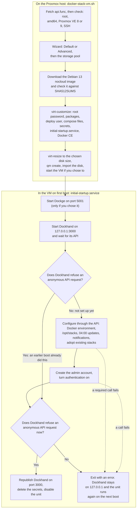

# docker-pve

[](LICENSE)
[](https://github.com/rob-paprocki/docker-pve/releases)
[](https://github.com/rob-paprocki/docker-pve/actions/workflows/lint.yml)
[](https://pve.proxmox.com/)

docker-pve is a script you run on a Proxmox VE host to create a Debian 13 VM with Docker and [Dockhand](https://dockhand.pro) installed, and Dockhand configured and password-protected before your network can reach it.

It's for people who run Proxmox VE at home or in a small lab and want a VM for Docker Compose stacks without building one by hand each time. Doing it by hand means creating the VM, installing Docker from Docker's repository, adding a web UI to manage containers, and then creating that UI's admin account before anyone else on the network does. With this script, a whiptail wizard asks for the VM's basics, everything else is written into the disk image before the VM first boots, and the VM sets Dockhand up on that first boot. [Dockge](https://github.com/louislam/dockge) is available as an optional second compose UI.

It pairs with [qbittorrent-vpn-docker](https://github.com/rob-paprocki/qbittorrent-vpn-docker), a qBittorrent stack behind a Gluetun VPN container, which is designed to live under `/opt/stacks/` on the VM this script creates.

**Contents:** [Highlights](#highlights) · [How it works](#how-it-works) · [Quick start](#quick-start) · [Configuration](#configuration) · [What the VM contains](#what-the-vm-contains) · [Trust model and security](#trust-model-and-security) · [Troubleshooting and FAQ](#troubleshooting-and-faq) · [Known limitations](#known-limitations) · [Getting help](#getting-help) · [Contributing](#contributing) · [Changelog and versioning](#changelog-and-versioning) · [Licence](#licence) · [Credits](#credits)

## Highlights

- Builds the VM from Debian's official 13 (trixie) `nocloud` cloud image, checked against Debian's `SHA512SUMS`, with Docker CE and the Compose plugin from Docker's own apt repository.
- Writes the packages, compose files and first-boot service into the image with `virt-customize` before the first boot, so the VM needs no cloud-init. The container images are pulled on first boot.
- Gives Dockhand an `admin` account and turns its authentication on before publishing it on port 3000. If any required step fails, Dockhand stays on `127.0.0.1` and setup runs again on the next boot.
- Schedules a nightly image update at 04:00 in the Proxmox host's timezone. An update whose new image has more known vulnerabilities than the running one is blocked, and the results can go to a notification channel.
- Keeps passwords off every command line. The first-boot copies sit in a root-only folder and are deleted once setup succeeds.
- Pins its remote inputs where it can: the community-scripts helper file by commit, the Dockhand and Dockge images by tag. Each pin can be overridden with an environment variable.
- Prepares the VM for the paired stack: a `deploy` user with uid and gid 1000 in the `docker` group, plus `git` and `python3-venv`.

## How it works

The script runs on the Proxmox host and does all its customisation on the downloaded disk image. The VM then finishes the job on its first boot, and the two questions in that half of the diagram are the [first-boot lock-down](#first-boot-lock-down).



## Quick start

### Requirements

| Requirement | Details |
|---|---|
| Proxmox VE | 8.0 to 8.9 or 9.0 to 9.9, on an amd64 host. The script exits on any other version or architecture. |
| Shell | A root shell on the Proxmox node. The script refuses to run as another user or through `sudo`. Over SSH it asks you to confirm and suggests the Proxmox web shell instead. |
| Storage | At least one storage that accepts VM disk images. If there are several, the script asks which one to use. |
| Host network | Outbound HTTPS to `raw.githubusercontent.com` (this script and `api.func`), `cloud.debian.org` (the image and `SHA512SUMS`), and `download.docker.com` and the Debian package mirrors (packages installed into the image). If the script has to install `libguestfs-tools`, it also needs the host's own apt repositories. |
| VM network | A DHCP server on the VM's bridge, and access to Docker Hub on first boot to pull the Dockhand image (and Dockge's). |
| Host tools | `whiptail`, `curl`, `openssl`, `sha512sum`, `qemu-img`, `qm`, `pvesm`, `pvesh` and `pveversion`, all standard on Proxmox VE. If `virt-customize` is missing, the script installs `libguestfs-tools` first. |

### Run it

As root on the Proxmox host:

```bash
bash -c "$(curl -fsSL https://raw.githubusercontent.com/rob-paprocki/docker-pve/main/docker-stack-vm.sh)"
```

Confirm the first prompt, then answer **Yes** to "Use Default Settings?" for a VM with the defaults below and a single password prompt, or choose **Advanced** to set everything yourself.

> [!CAUTION]
> This runs a script from the internet as root on your Proxmox host, and that script sources a second file, `api.func`, from the community-scripts/ProxmoxVE repository. Read both before you run them on a host you care about ([trust model](#trust-model-and-security)). To run a fixed version instead of the moving `main` branch, replace `main` in the URL with a release tag or a commit SHA.

### After it finishes

1. Find the VM's IP address on its **Summary** tab in Proxmox (the guest agent reports it). Give first boot a few minutes to pull the Dockhand image and configure it before port 3000 opens.
2. Open `http://<vm-ip>:3000` and log in as `admin` with the Dockhand password you set in the wizard (in Default mode, the root password). Everything under [Dockhand's first-boot setup](#dockhands-first-boot-setup) is already done. If the page doesn't load, see [the first FAQ entry](#troubleshooting-and-faq).
3. If you installed Dockge, open `http://<vm-ip>:5001` and create its admin account. Use Dockge to read logs and edit files, not to start or update stacks ([why](#troubleshooting-and-faq)).

> [!IMPORTANT]
> Dockge gets none of the first-boot lock-down. First boot publishes it on port 5001 straight away, before Dockhand, and the first person to open it creates its admin account, so do step 3 as soon as you can.

4. Deploy a stack. For the paired qBittorrent stack, as root on the VM:

   ```bash
   cd /opt/stacks
   git clone https://github.com/rob-paprocki/qbittorrent-vpn-docker.git torrent-stack
   cd torrent-stack
   ./scripts/setup.sh   # serves that stack's env-editor on port 9191; follow its README
   ```

   Then pick it up in Dockhand under **Stacks → Adopt**. Dockhand names the stack `torrent-stack` from its compose file. Clone into a `torrent-stack` folder anyway, because Dockge names stacks after their folder and shows the stack twice when the two names differ.

## Configuration

### Wizard options

After a first "Proceed?" confirmation, the wizard asks "Use Default Settings?". **Default** asks for one password and uses the values in the middle column. **Advanced** asks every question in the right-hand column, in that order, then asks "Ready to create the VM?". Answering **Do-Over** there starts the questions again.

| Setting | Default mode | Advanced mode |
|---|---|---|
| VM ID | Next free ID | Asked; defaults to the next free ID. An ID already in use is refused and asked again. |
| Machine type | i440fx | i440fx (default) or q35. Both boot with UEFI. |
| Disk size | 25 GiB | Asked in GiB; default `25G`. A plain number such as `40` also works; any other format stops the script. |
| Hostname | `docker` | Asked; default `docker`. Converted to lower case with spaces removed. |
| CPU cores | 2 | Asked; default 2 |
| RAM | 4096 MiB | Asked in MiB; default 4096 |
| Bridge | `vmbr0` | Asked; default `vmbr0` |
| MAC address | Random, locally administered (`02:…`) | Asked; defaults to the random one. Blank also means the random one. |
| IPv6 | On | Yes or no; default yes. No writes a sysctl file that turns IPv6 off in the guest. |
| Notification URL | None | Optional. An Apprise-style URL for Dockhand's update results ([formats](#troubleshooting-and-faq)). |
| Root password | Asked; at least 8 characters, because it's also the Dockhand password | Asked; required |
| Dockhand `admin` password | Same as the root password | Asked; at least 8 characters, Dockhand's own minimum |
| Install Dockge | No | Yes or no; default no |
| SSH public key for `deploy` | None | Optional. Must start with an OpenSSH key type such as `ssh-ed25519`; anything else is dropped with a message. |
| Root SSH login | Off | Yes or no; default no. Yes sets `PermitRootLogin yes` and, if you gave a key, adds it for root too. |
| Start VM when done | Yes | Yes or no; default yes |

In both modes the script then asks which storage pool to use, if more than one accepts disk images.

Neither mode asks for a static IP, so the VM always starts on DHCP. [The FAQ](#troubleshooting-and-faq) explains why and what to do instead.

These settings are the same in both modes:

| Setting | Value |
|---|---|
| Firmware | UEFI (OVMF) with a 4 MiB EFI vars disk |
| Disk controller | VirtIO SCSI. On storage other than directory, NFS or Btrfs, the disk also gets `discard=on,ssd=1`. |
| Network | VirtIO NIC on the chosen bridge, DHCP, no VLAN tag or MTU. Set those on the VM's network device in Proxmox if you need them. |
| Guest agent | Installed in the guest and enabled on the VM |
| Start at host boot | On |
| Serial console | `serial0` socket |
| Tags | `docker`, `dockhand`, `debian13`, and `dockge` when installed |
| Timezone | Dockhand, Dockge and the update schedule use the Proxmox host's timezone, or `Etc/UTC` if the script can't read one. The guest system's own timezone is left as the image ships it. |
| Notes | The VM's Notes panel links to `http://<hostname>:3000` (and `:5001` with Dockge) |

### Environment variables

The script reads these from its environment. Put them before `bash` in the one-liner:

```bash
DIAGNOSTICS=no DOCKHAND_IMAGE=registry.example.lan/fnsys/dockhand bash -c "$(curl -fsSL https://raw.githubusercontent.com/rob-paprocki/docker-pve/main/docker-stack-vm.sh)"
```

| Variable | Default | What it does |
|---|---|---|
| `DIAGNOSTICS` | Unset, which `api.func` treats as `no` | Read by the sourced `api.func`, not by this script. At the pinned `API_FUNC_REF`, `api.func` uploads only when `DIAGNOSTICS` isn't `no` and a session ID (`RANDOM_UUID`) is set. This script never sets `RANDOM_UUID`, so it uploads nothing whatever `DIAGNOSTICS` says. If `/usr/local/community-scripts/diagnostics` exists on the host, its `DIAGNOSTICS=` line replaces the environment value. |
| `API_FUNC_REF` | `500a860faf7295e6dad20670d05e6400d18f66b0` | The [community-scripts/ProxmoxVE](https://github.com/community-scripts/ProxmoxVE) commit whose `misc/api.func` is fetched and sourced. The script exits if the fetch fails or comes back empty. |
| `DOCKHAND_IMAGE` | `fnsys/dockhand` | The Dockhand image written into `/opt/dockhand/compose.yaml`, without the tag. Point it at a copy in your own registry if the VM can't reach Docker Hub. |
| `DOCKHAND_TAG` | `v1.0.57` | The Dockhand image tag. First boot configures Dockhand through its HTTP API, so a tag that changes that API makes first boot fail; Dockhand then stays on `127.0.0.1`. |
| `DOCKGE_TAG` | `1.5.0` | The `louislam/dockge` image tag. Used only when you install Dockge. |

## What the VM contains

| Service | Image | Port | Folder | Role |
|---|---|---|---|---|
| Dockhand | `fnsys/dockhand:v1.0.57` | 3000 (HTTP) | `/opt/dockhand` | Docker manager and image updater |
| Dockge (optional) | `louislam/dockge:1.5.0` | 5001 (HTTP) | `/opt/stacks/dockge` | Second compose UI; Advanced mode only |

Earlier versions installed Portainer and Watchtower. Dockhand replaces both, handling image updates as well as container, image, volume and network management.

The VM also gets:

- Docker CE (`docker-ce`, `docker-ce-cli`, `containerd.io`, `docker-compose-plugin`) from Docker's Debian repository.
- `qemu-guest-agent`, with the agent enabled on the VM, so the Proxmox UI can read the VM's IP and shut it down cleanly.
- A `deploy` user (uid and gid 1000, in the `docker` group, no password) so stacks that run as `PUID=1000`/`PGID=1000`, such as [qbittorrent-vpn-docker](https://github.com/rob-paprocki/qbittorrent-vpn-docker), can own their data folders under `/opt/stacks/` directly. Log in as `deploy` with the SSH key from the wizard, or with `su - deploy` from root.
- `openssh-server`, `git` and `python3-venv`. The paired stack needs the last two: `git` to clone it, and `python3-venv` so its host-side setup editor (`scripts/setup.sh`) can build its Python venv. The Debian 13 `nocloud` image ships `python3` but neither of these.
- `initial-startup.service`, which runs on first boot, starts Dockge (if you chose it) and Dockhand, configures Dockhand, and disables itself once it succeeds.
- An empty `/etc/machine-id`, so the VM generates its own on first boot.

| Path | What it holds |
|---|---|
| `/opt/stacks/` | Your stacks. Dockhand scans it and creates new stacks in it, so Dockhand, Dockge and the `docker compose` CLI all work on the same `compose.yaml` files. |
| `/opt/dockhand/compose.yaml` | Dockhand's compose file |
| `/opt/dockhand/data/` | Dockhand's data |
| `/opt/dockhand/firstboot.env` | The VM's hostname and the host's timezone, for the first-boot script |
| `/opt/stacks/dockge/` | Dockge's compose file and data, when installed |
| `/opt/dockhand_secrets/` | The Dockhand password and notification URL, until first boot succeeds (folder 0700, files 0600) |
| `/usr/local/bin/initial-startup.sh` | The first-boot script that `initial-startup.service` runs |

### Dockhand's first-boot setup

On first boot, `initial-startup.service` sets Dockhand up with:

- the VM's local Docker socket as its environment, named after the VM's hostname;
- `/opt/stacks` as the folder it scans for stacks, and as the folder for stacks you create in Dockhand;
- a nightly update at 04:00 in the Proxmox host's timezone. Every container is checked for a newer image and updated. If the new image has more known vulnerabilities than the one it replaces, the update is blocked and reported instead. Containers that share another container's network (the paired stack's qBittorrent shares Gluetun's) are reconnected when their parent is updated;
- the stacks already in `/opt/stacks` adopted, which at first boot means Dockge's own stack if you installed it;
- a notification channel called "Update results" for succeeded, failed and blocked updates, if you gave a notification URL;
- an `admin` account, with local authentication on.

Dockhand doesn't update itself on that schedule. It shows a new release in its sidebar and updates itself when you click it. Afterwards, set the new tag in `/opt/dockhand/compose.yaml`, so a later `docker compose up -d` there doesn't roll it back.

## Trust model and security

### What you're trusting

Several remote inputs go into the VM. Before you run this on infrastructure you care about, look at where each one comes from and how it's checked:

| Input | Fetched from | How it's checked |
|---|---|---|
| This script | `raw.githubusercontent.com/rob-paprocki/docker-pve` | HTTPS only. Pin the URL to a tag or commit if you don't want the moving `main`. |
| `api.func` | `raw.githubusercontent.com/community-scripts/ProxmoxVE` at `API_FUNC_REF` | Pinned to a commit, so a change on that repository's `main` can't reach you silently. The script exits if the fetch fails. |
| Debian 13 `nocloud` image | `cloud.debian.org/images/cloud/trixie/latest/` | Checked against the published `SHA512SUMS`, which covers integrity only. Debian's cloud team doesn't sign per-distribution images consistently, so GPG verification is deferred and authenticity rests on HTTPS to `cloud.debian.org`. |
| Docker CE packages | `download.docker.com` | Docker's apt signing key, itself fetched over HTTPS during the build |
| Debian packages | The Debian mirrors configured in the image | Debian's archive signatures |
| Dockhand and Dockge images | Docker Hub, on first boot | Pinned by tag, not by digest |

`api.func` provides the two telemetry functions this script calls, `post_to_api_vm` and `post_update_to_api`. Because it's sourced, its code runs as root in the script's shell, which is why it's pinned. At the pinned commit those functions post to `telemetry.community-scripts.org` only under the conditions in the [`DIAGNOSTICS` row](#environment-variables). This script doesn't meet them, so as shipped nothing is uploaded.

### First-boot lock-down

Dockhand starts with authentication off and lets whoever reaches it first create the admin account. `initial-startup.service` therefore publishes Dockhand on `127.0.0.1` only, configures it and creates the `admin` account through its API, turns authentication on, and republishes it on port 3000 only after an anonymous API request is refused. The admin password and notification URL wait in `/opt/dockhand_secrets` and are deleted once that succeeds.

If a required step fails, Dockhand stays on `127.0.0.1`, the secrets stay in place, and the service runs again on the next boot. A bad notification URL or a failed stack adoption only logs a warning. `journalctl -u initial-startup` on the VM shows what happened.

### Residual risks

> [!WARNING]
> Dockhand and Dockge serve plain HTTP, so their passwords cross the network in the clear. Firewall ports 3000 (and 5001 with Dockge) off the WAN side, and put a TLS reverse proxy in front of them if the VM is reachable from networks you don't trust.

- Dockhand, and Dockge when installed, have unrestricted access to `/var/run/docker.sock` on the guest, so a compromise of either is root on the guest. Dockhand also runs as root inside its container, which is its default.
- The `deploy` user is in the `docker` group, which is equivalent to root on the guest.
- The nightly update pulls and applies new images automatically. Blocking updates that add known vulnerabilities doesn't catch a malicious image with no known CVEs.
- Dockge has no first-boot lock-down; see [After it finishes](#after-it-finishes).

[SECURITY.md](.github/SECURITY.md) lists the known residual risks and says how to report a new one.

### Dockhand's licence

Dockhand is source-available under the Business Source License 1.1, not open source. Each version converts to Apache 2.0 four years after its release, and Dockhand's pricing page sells a separate commercial-use licence. This repository doesn't include Dockhand; the VM pulls its image from Docker Hub on first boot.

## Troubleshooting and FAQ

<details>
<summary>Dockhand's page doesn't load after first boot</summary>

First boot pulls the Dockhand image, waits up to three minutes for its API, and configures it before port 3000 opens to the network, so give it a few minutes. If it still doesn't load, log in to the VM as root (the **Console** in Proxmox works in every mode) and run:

```bash
journalctl -u initial-startup -b
docker ps
```

If `docker ps` doesn't list Dockhand at all, the image pull failed, so check that the VM can reach Docker Hub. If it shows Dockhand on `127.0.0.1:3000->3000/tcp`, first boot hasn't finished, and the log names the call that failed; a `DOCKHAND_TAG` override whose API differs from what the script expects is one cause. Fix the cause, then run `systemctl start initial-startup` or reboot. The script reuses whatever an earlier run created, so running it again is safe.

</details>

<details>
<summary>How do I give the VM a static IP?</summary>

The wizard can't set one. The `nocloud` image this script downloads has no cloud-init, and Proxmox's `--ipconfig0` only takes effect through cloud-init, so a static-IP prompt would silently discard the value. Reserve an address for the VM's MAC address on your DHCP server (the MAC is on the VM's **Hardware** tab), or change the network configuration inside the guest after first boot. Moving to the `genericcloud` image with cloud-init would bring the prompt back; see [Known limitations](#known-limitations).

</details>

<details>
<summary>Why shouldn't I use Dockge's Start, Update or Deploy buttons?</summary>

Dockge runs its own bundled Docker Compose (v2.34.0 in Dockge 1.5.0), not the VM's `docker-compose-plugin`. The two compute different config hashes, so Dockge's Start, Update and Deploy buttons recreate every container in the stack. Use Dockge for reading logs and editing files, and deploy from Dockhand or with `docker compose` on the VM.

</details>

<details>
<summary>What notification URL formats does Dockhand accept?</summary>

Dockhand takes Apprise-style URLs. The wizard's prompt names `ntfys://`, `discord://`, `tgram://`, `gotify://`, `slack://` and `pover://`. Some examples:

| Service | Example |
|---|---|
| ntfy over HTTPS | `ntfys://ntfy.example.com/updates` |
| Discord | `discord://webhook_id/webhook_token` |
| Telegram | `tgram://bot_token/chat_id` |
| Gotify | `gotify://host/token` |
| Pushover | `pover://user_key@api_token` |

These differ from the Shoutrrr URLs that earlier versions passed to Watchtower. A URL Dockhand rejects at first boot only logs a warning. In Default mode there's no prompt at all. Either way, add or fix the channel in Dockhand under **Settings → Notifications**.

</details>

<details>
<summary>How do I turn off diagnostics?</summary>

With the pinned `api.func`, this script uploads nothing, so there's nothing to turn off (the [`DIAGNOSTICS` row](#environment-variables) explains why). If you point `API_FUNC_REF` at a newer commit, check what that version sends, and prefix the one-liner with `DIAGNOSTICS=no`:

```bash
DIAGNOSTICS=no bash -c "$(curl -fsSL https://raw.githubusercontent.com/rob-paprocki/docker-pve/main/docker-stack-vm.sh)"
```

If `/usr/local/community-scripts/diagnostics` exists on the host, its `DIAGNOSTICS=` line overrides the environment, so set it to `no` there too.

</details>

<details>
<summary>How do I get a shell on the VM?</summary>

Log in as root with the root password on the VM's **Console** in Proxmox. Over SSH, OpenSSH's default (`PermitRootLogin prohibit-password`) refuses root password logins, so:

- In Default mode there's no SSH key, so use the console.
- In Advanced mode, if you pasted a key, log in as `deploy` with it. If you allowed root SSH login, root can log in with its password, and with the key if you gave one.

</details>

<details>
<summary>How do I update Dockhand or Dockge?</summary>

Dockhand: click the new release in Dockhand's sidebar, then set the same tag in `/opt/dockhand/compose.yaml`. Dockge: edit the tag in `/opt/stacks/dockge/compose.yaml` and run `docker compose up -d` in that folder. [UPSTREAMS.md](UPSTREAMS.md) lists what to check before a Dockge bump.

</details>

<details>
<summary>The script stopped with an error. What's left behind?</summary>

If the error came after the VM was created, the script stops and destroys that VM. Pressing Ctrl+C doesn't, so look for a half-built VM if you interrupt a run. The temporary folder with the image and passwords is removed on every exit. Errors before that (a failed `api.func` fetch, a `SHA512SUMS` mismatch, no usable storage) leave nothing to clean up. Fix the cause and run the one-liner again.

</details>

<details>
<summary>I used an earlier version with Portainer and Watchtower</summary>

This version installs Dockhand instead of both, with Dockge as an option. Re-running the one-liner creates a new VM and doesn't touch existing ones. Notification URLs are now Apprise-style, not Shoutrrr. [CHANGELOG.md](CHANGELOG.md) has the details.

</details>

## Known limitations

- No static IP prompt. It needs the `genericcloud` image and cloud-init.
- No GPG check of the Debian image, until Debian's cloud team signs per-distribution images. The monthly [external-upstream-watch](.github/workflows/external-upstream-watch.yml) workflow opens an issue when a signature file appears, and another when `api.func` gets new commits after the pin.
- amd64 only. The script exits on other architectures, such as Proxmox on ARM (PiMox).
- Each run downloads the current `trixie/latest` image and the current Docker CE packages, so two runs weeks apart can produce slightly different VMs. Only `api.func` and the two container images are pinned.

## Getting help

- Questions, bugs and feature requests: [open an issue](https://github.com/rob-paprocki/docker-pve/issues). Include your Proxmox VE version (`pveversion`), whether you used Default or Advanced mode, the last lines of the script's output, and for first-boot problems the output of `journalctl -u initial-startup -b` from the VM.
- Problems with the qBittorrent stack itself: its [own issue tracker](https://github.com/rob-paprocki/qbittorrent-vpn-docker/issues).
- Security vulnerabilities: don't open a public issue. Follow [SECURITY.md](.github/SECURITY.md), which says how to report one privately.

This is a hobby project with one maintainer, [Rob Paprocki](https://github.com/rob-paprocki), so replies can take a few days.

## Contributing

Pull requests are welcome. The repository's rules are in [CLAUDE.md](CLAUDE.md) and apply to every contributor, whether a person or an agent. In short:

- Open the pull request against `main`. The [pull request template](.github/pull_request_template.md) asks for a summary, a test plan and a one-line rollback.
- The [lint workflow](.github/workflows/lint.yml) runs `shellcheck` at warning severity on every pull request to `main` and every push to it. Keep it passing; the pull request template asks you to confirm it does. To run the same check before you push, use `shellcheck --severity=warning docker-stack-vm.sh`, which picks up the repository's `.shellcheckrc`.
- Test your branch on a Proxmox VE host before you open the pull request. The script fetches nothing else from this repository, so the one-liner pointed at your fork and branch runs your version end to end:

  ```bash
  bash -c "$(curl -fsSL https://raw.githubusercontent.com/<your-user>/docker-pve/<your-branch>/docker-stack-vm.sh)"
  ```

  Then check `journalctl -u initial-startup -b` on the new VM, and say what you ran in the test plan.
- Add a line under `## [Unreleased]` in [CHANGELOG.md](CHANGELOG.md) for anything a user could notice, under `Added`, `Changed`, `Deprecated`, `Removed`, `Fixed` or `Security`. Breaking changes start with **BREAKING:** and say how to adapt. CI-only and housekeeping changes can skip it.
- When you change behaviour, update this README in the same pull request.
- Run user-facing text through the two humanizer passes CLAUDE.md describes, then re-check every fact against the script.
- To bump a pinned image or `api.func`, follow [UPSTREAMS.md](UPSTREAMS.md). Dependabot only bumps GitHub Actions versions; the rest is done by hand.

[CODEOWNERS](.github/CODEOWNERS) assigns every file to the repository owner, so GitHub requests their review on every pull request.

## Changelog and versioning

[CHANGELOG.md](CHANGELOG.md) records every change a user could notice, in [Keep a Changelog 1.1.0](https://keepachangelog.com/en/1.1.0/) format. Releases follow [Semantic Versioning 2.0.0](https://semver.org/spec/v2.0.0.html) and are tagged `vMAJOR.MINOR.PATCH`, each with a GitHub Release.

The version protects what you rely on when you run the script: the one-liner and the script's name, the wizard's modes, prompts and defaults, the environment variables above, the VM's services, ports, `deploy` user and paths, the first-boot behaviour, and what the paired stack depends on. A MAJOR bump means re-running the one-liner gives a VM that no longer works the way this README says. Only the current `main` branch gets fixes; there are no backported releases ([SECURITY.md](.github/SECURITY.md)).

## Licence

MIT; see [LICENSE](LICENSE). The whiptail UI pattern, the `get_valid_nextid` helper and the `api.func` sourcing are adapted from the [community-scripts/ProxmoxVE](https://github.com/community-scripts/ProxmoxVE) project, copyright © 2021-2025 community-scripts ORG. All additions in this script are copyright © 2025 Rob Paprocki.

The MIT licence covers this repository only. Dockhand and Dockge are separate projects under their own licences ([Dockhand's](#dockhands-licence) is not open source).

## Credits

- [community-scripts/ProxmoxVE](https://github.com/community-scripts/ProxmoxVE), for the helper-script pattern this script follows and the `api.func` it sources.
- [Dockhand](https://github.com/Finsys/dockhand) by Finsys, and [Dockge](https://github.com/louislam/dockge) by Louis Lam.
- The [Debian Cloud Team](https://cloud.debian.org/images/cloud/), for the cloud images.
- [libguestfs](https://libguestfs.org/), for `virt-customize` and `virt-resize`.
- [NulightJens/humanizer-stack](https://github.com/NulightJens/humanizer-stack) (MIT), for the writing checks vendored in `.claude/skills/`.
